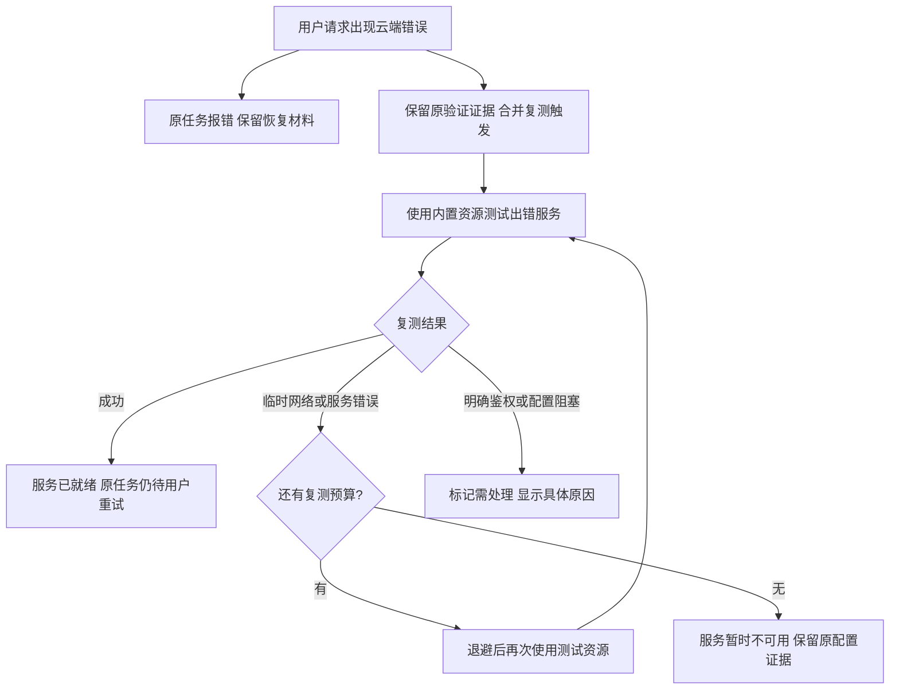
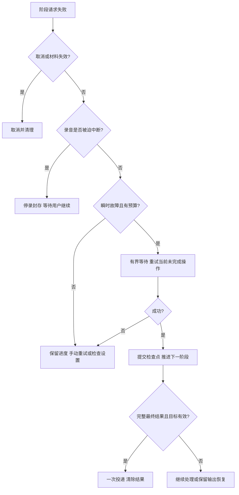

# 语音与 AI 服务闪断恢复方案

状态：第 6 节独立复测及状态重试入口已实现并完成本地打包、安装重启；全量 909 项测试、9 项外部服务测试跳过、0 失败，其后恢复入口门禁补充的最终定向回归 117 项、0 失败。用户已确认本地版本无问题，并授权推送与发布下一测试版；所有厂商及故障组合的真实联调不因此自动视为通过。第 4–5 节业务自动恢复及不断录重连仍待后续评审。日期：2026-10-19。

本方案基于当前工作区代码与 PRD / TDD，回应“服务端闪断后客户端无法自助恢复”。根据 2026-10-19 用户反馈，本轮优先方向调整为：**使用过程报错后，保留原任务，使用独立测试资源进行有界复测；由复测结果判定服务状态，不直接用业务错误撤销配置的验证通过状态。**

用户已确认按第 6 节实施并要求本地打包、重启应用供验证，跟踪 [Issue #21](https://github.com/isecret/MemoEcho/issues/21)。PRD §8.10 与 TDD §5.1.2 已同步确认行为。原用户请求自动重试（第 4–5 节）保留为后续候选，不随独立复测一并启用。独立复测不会重发用户内容，测试通过也不自动恢复原任务；“全程不断录”继续列为后续可选项。下文“现状”记录实施前基线，不代表新增行为已验收。

## 1. 实施前基线与问题依据

### 1.1 已有能力

| 能力 | 当前实现 |
| --- | --- |
| 从失败阶段继续 | `SessionRecoveryCheckpoint` / `SessionRecoveryProcessor` 保存未完成输入，跳过成功阶段 |
| 分段语音恢复 | 保留失败段、后续段和成功转写；逐段串行重试 |
| 实时语音恢复 | 保存未确认的已处理 PCM 和未处理尾部 PCM，使用原平台实时协议重放 |
| AI 恢复 | 整理失败复用完整转写；翻译失败复用润色结果 |
| 用户入口 | HUD“重试 / 继续”和菜单栏“恢复上次输入” |
| 隐私与互斥 | 恢复材料仅内存保留，首次失败后 10 分钟到期；单 active session；代次检查防迟到结果 |
| 输出保护 | 一次定向粘贴，已投递不再恢复写入；失败可手动复制最终结果 |

因此问题不是完全没有恢复能力，而是缺少自动恢复，以及临时故障与配置失败的状态隔离。

### 1.2 实施前代码中已确认的缺口

1. **暂时失败会阻塞后续录音。** `AppCoordinator.invalidateFailedConfiguration()` 将网络失败、空响应等交给验证服务失效处理。两类验证服务即使收到 `isTransient: true` 仍设为 `.failed`；云 ASR 还写入配置验证失败状态。`validate(force: false)` 又复用同一配置的失败结果；`RecordingStartGate` 根据就绪快照阻止开始录音。菜单仅隐藏瞬时失败告警，没有解除录音入口的阻塞。
2. **当前请求没有通用瞬时故障重试。** LLM 的 `thinking` 不兼容回退只解决字段兼容，不是网络重试；ASR / LLM 网络失败直接交给失败恢复流程。
3. **分类依据在错误映射时丢失。** 多个 HTTP Provider 将状态码或 `URLError` 压成字符串；实时 `sanitized` / `mapError` 把多类错误归为连接中断或网络失败。单凭现有“网络错误”无法区分限流、余额不足、证书错误、协议错误及真正闪断。
4. **实时恢复的中间进度没有回写。** `RealtimeRecognitionPipeline.replay()` 仅在整次成功时返回文本；若重放跨多个原生任务，前面已完成但后面失败，原 checkpoint 仍保留整份音频。再次恢复会重跑已完成部分，尚未处理的原 PCM 也可能再次降噪。
5. **LLM 润色与翻译分别处理网络响应。** 只给润色加重试会漏掉翻译；取消也不能再被包装成普通网络故障。
6. **已有独立测试资源，但复测覆盖不一致。** `ASRValidationAudio` 加载内置合成语音 `asr-validation.wav`，实时 ASR 与多个 HTTP 入口已经使用；腾讯一句话仍发送短静音，阿里一句话仅取 Token。LLM `validateConfiguration()` 使用固定文案“请回复 ok。”并解析润色结构。需要统一测试用途与覆盖范围，不能把鉴权成功当作完整识别成功。

以上是实施前的静态代码核对结果，不能据此断定某次用户实际故障属于哪一种。本轮已按第 6 节修正业务错误直接使配置失效、独立验证覆盖不一致及运行健康隔离问题；业务请求自动恢复与实时恢复中间进度仍属后续范围。

主要依据：[PRD §8.9](../PRD.md#89-从失败阶段继续)、[TDD §5.2.1](../TDD.md#521-sessionrecoverycheckpoint--sessionrecoveryprocessor)、[实时 ASR 方案 §6](./realtime-asr.md#6-超时失败与恢复)。关键代码：

- [AppCoordinator](../../app/MemoEcho/Domain/Coordinators/AppCoordinator.swift)、[RecordingStartGate](../../app/MemoEcho/Domain/Coordinators/RecordingStartGate.swift)
- [LLMValidationService](../../app/MemoEcho/Domain/Services/LLMValidationService.swift)、[CloudASRValidationService](../../app/MemoEcho/Domain/Services/CloudASRValidationService.swift)、[VoiceInputReadinessService](../../app/MemoEcho/Domain/Services/VoiceInputReadinessService.swift)
- [SessionCoordinator](../../app/MemoEcho/Domain/Coordinators/SessionCoordinator.swift)、[SessionRecoveryCheckpoint](../../app/MemoEcho/Domain/Services/SessionRecoveryCheckpoint.swift)
- [RealtimeRecognitionPipeline](../../app/MemoEcho/Domain/Services/RealtimeRecognitionPipeline.swift)、[RealtimeASRSession](../../app/MemoEcho/Providers/Realtime/RealtimeASRSession.swift)、[RealtimeCloudASRSession](../../app/MemoEcho/Providers/Realtime/RealtimeCloudASRSession.swift)
- [LLMProvider](../../app/MemoEcho/Providers/LLMProvider.swift)

## 2. 推荐交付范围与用户体验

本轮独立复测方案包含：独立测试资源、运行时故障触发、复测合并与预算、服务状态判定、设置与录音门禁联动、原任务手动恢复。完成这些工作可交付“运行时错误后独立复测”，不宣称已具备业务请求自动恢复。

下表是后续完整恢复方案的候选体验，其中涉及自动重发用户数据的部分仍待单独评审：

| 发生时机 | 推荐行为 | 用户看到什么 |
| --- | --- | --- |
| 整理 / 翻译遇到瞬时故障 | 自动重试当前阶段；上游结果保留 | “正在重试整理…” / “正在重试翻译…”，可取消 |
| 用户已结束录音，HTTP ASR 失败 | 自动重试当前失败段，之后继续串行处理 | “正在重试识别…”，可取消 |
| 用户已结束录音，实时发送或 final 等待失败 | 关闭旧任务，从最后完整确认边界重放未确认音频 | “正在恢复识别…”，可取消；恢复可能与待重放音频一样长 |
| 尚在录音，HTTP ASR 或实时服务失败 | 停止采集并封存尾部；保留进度，等待用户“继续处理已录内容” | “录音已中断” + “继续”；不暗示用户可以继续说 |
| 自动重试仍失败 / 不满足自动条件 | 回到可恢复失败状态，保留进度 | HUD“重试”，菜单提供阶段动作和原因 |
| 瞬时故障后开始下一次录音 | 已验证且配置未变时允许新的主动尝试 | 不强迫打开设置或重复保存配置 |
| 云端返回鉴权、资源或请求错误 | 原请求不盲目重发；用独立资源复测，再决定服务状态 | “检查中…”；复测确认阻塞后才引导设置 |
| 本地配置缺字段、系统权限或设备错误 | 直接提示相应本地问题，不发起必然无效的云复测 | 对应修复入口 |

**录音中途被迫停止意味着用户的话可能尚未说完。** 这类任务仍需用户点击“继续”确认处理已录部分，不能因为服务恢复就把半句话自动写入。用户已主动结束的完整录音，才允许自动恢复后进入正常输出。故障与停止快捷键同时发生时，以 Coordinator 串行接受的用户结束意图及采集关闭屏障判断；有丢帧、采集错误或无法确定完整性时按中断录音处理。

恢复期间仍只占用一个 active session，自动恢复不重新开启麦克风、不播放录音开始音效。用户取消后可开始新录音。只有所有 ASR 完成、LLM 成功且原输出目标符合现有要求，才允许一次投递。

## 3. 故障分类与重试资格

Provider 保留结构化失败信息，Domain 决定恢复策略，UI 使用脱敏文案。新增内部 `ServiceFailure` 元数据包装，不破坏现有持久化配置或一次性替换全部 `MemoEchoError`。

建议字段：服务 / 阶段、失败类别、HTTP 状态码、白名单厂商错误码、`URLError.Code`、已解析的 `retryAfter`、请求是否可能已到达服务端、原配置身份、请求代次。不得携带响应正文、URL 查询参数、音频、文字或凭据到日志。厂商响应在适配器内解析后丢弃非必要内容。

| 故障 | 原业务请求自动处理候选 | 是否直接否定配置有效性 |
| --- | --- | --- |
| 连接被重置、连接意外关闭、临时连接失败 | 满足阶段与预算条件时重试 | 否 |
| 请求超时 / 实时 final 超时 | 结果未知，按可重放推理请求处理；不承诺服务端未执行 | 否 |
| HTTP 408、500、502、503、504 | 默认候选；厂商明确永久错误优先排除 | 否 |
| HTTP 429 / 明确临时限流码 | 遵守 `Retry-After`；等待超预算则手动恢复 | 否 |
| 明确断网 | 仅本次任务在剩余等待预算内等网络恢复；不连续发送必败请求 | 否 |
| DNS 查询失败、未知网络错误 | 默认不自动；仅已确认的临时类型进入白名单 | 否，不直接推断配置错误 |
| 云端 401 / 403、模型不存在、接口路径错误 | 不重发原内容，独立复测确认原因 | 否；复测明确失败后才标记对应阻塞 |
| 余额不足、未开通服务、永久额度耗尽 | 不重发原内容；独立复测，不能把所有 429 都当短期限流 | 否；复测确认后标记对应服务阻塞 |
| TLS / 证书 / 重定向被拒绝 | 不重发原内容，独立复测保持相同安全校验 | 否；复测仍失败则提示连接安全问题 |
| 本地配置缺字段或地址不安全 | 本地预检阻止请求，不绕过校验做复测 | 标记可直接确认的本地阻塞 |
| 200 但空结果、JSON / 结构化输出无效、协议状态无效 | 不自动，保留可恢复材料供手动尝试 | 不等同于凭据错误 |
| 本地模型、降噪、音频设备、内存背压错误 | 使用对应本地恢复方式，不进入网络重试 | 不影响云配置 |
| 取消、过期、超过 8000 字符、没有有效音频 | 不重试；按既有规则清理 | 否 |

未知错误按“不自动重试、保留材料”处理。实时连接异常也必须保留握手 HTTP 状态及厂商拒绝码，不能一律映射为可重连。`CancellationError` 和 `URLError.cancelled` 优先透传，取消检查位于发送前、等待后和接收结果后。

## 4. 重试次数、等待与重复请求

本节专指未来原业务请求的自动重试；本轮独立复测使用第 6.4 节的专用预算。未经另行确认，不将本节的重发机制接入用户录音或文本。

### 4.1 首版建议参数

以下是待实测的内部默认值，不增加设置页高级参数。

| 项目 | 建议值及含义 |
| --- | --- |
| HTTP 单个逻辑操作 | 最多自动重试 1 次，即原始请求 + 1 次网络重试；操作指一个 ASR 分段、一次整理或一次翻译 |
| 退避 | 第一次自动重试前随机等待 0.5–1.5 秒，避免同一时刻集中重发 |
| `Retry-After` | 解析秒数和 HTTP 日期；实际等待不早于服务端要求，也不早于本地退避 |
| 自动等待上限 | 单次最多 5 秒；服务端要求更久则立即转手动恢复，保留该服务的最早允许再试时间，不能截断成 5 秒后提前重发 |
| LLM 操作总预算 | 最长 35 秒，包含首次请求、兼容回退、退避和网络重试；每个请求最长 15 秒，且受剩余预算约束 |
| HTTP ASR 操作总预算 | `2 × T + 5 秒`；`T = min(90, max(15, duration × 1.3 + 10))`，单次不超过 T |
| 实时恢复次数 | 用户已结束录音后最多自动重放 1 轮；重放内部无嵌套自动重连 |
| 单次处理尝试的额外请求总额 | 最多 3 次，覆盖所有分段和 AI 阶段；网络重试、兼容回退各扣 1 次，实时自动重放整轮扣 1 次，轮内任务受音频长度与次数上限约束 |

“处理尝试”指一次用户录音提交，或一次明确的手动“重试 / 继续”。用户手动操作可创建新的有界预算；不会延长原材料 10 分钟到期时间，也不能绕过 `Retry-After`。预算只计自动追加请求，正常长录音的原生任务轮转不受 3 次限制。录音中的首次故障已经停止采集，此时不自动消耗网络重试预算。

实时重放的时间预算单独计算：`D + W × (8 + 15) + 5 秒`，D 为尚未确认音频秒数，W 为原生任务数的保守上界。按现有静音轮转规则，令 `M = min(maximumSessionSeconds, maximumSilenceSeconds ?? maximumSessionSeconds)`，取 `W = ceil(D / M)`；这同时覆盖正常时长轮转与静音提前结束，不只按 90 秒估算。D 为 0 时不发起重放。每帧发送继续受 5 秒超时限制，整个重放还受 checkpoint 剩余寿命限制。按更小的剩余时间执行，预算耗尽即取消并保存当前有效进度；不能把 90 秒音频重放塞进 35 秒 LLM 超时。

总预算使用单调时钟，覆盖 DNS、连接、鉴权、发送、等待、回退和重试；不能仅设置 `URLRequest.timeoutInterval` 就宣称获得端到端硬上限。超时必须实际取消 / 关闭底层任务，避免超时包装器返回后旧连接继续占用或回写。

### 4.2 重试只有一个所有者

Domain 的 `RetryExecutor` 统一持有预算、等待、取消与尝试标识；Provider 执行单次请求并返回分类信息。实时管线拥有 PCM 与窗口恢复，消耗同一份预算；不得在 Provider、Pipeline、Coordinator 三层分别套重试循环。

LLM 既有 `thinking` 回退最多一次，只有明确字段不支持时触发；回退请求同样占用 35 秒时间与额外请求总额。每个 LLM 操作最多 3 次实际发送（原请求、一次兼容回退、一次网络重试），兼容模式一旦切换不得因网络重试退回旧模式。润色与翻译共用传输分类和取消处理，翻译不新增不需要的 `thinking` 回退。

自动尝试固定本次操作的服务身份、模型、音频、词典与业务输入；凭据、地址或模型被用户改动时停止旧自动重试，转手动恢复，避免静默向另一服务重发。手动恢复沿用原模式、语言、上下文和原 ASR 平台，读取该平台最新凭据及当前 LLM 配置。每次实际 LLM 发送前仍读取上下文隐私开关，关闭后剔除上下文；不得为了字节完全一致而绕过隐私设置。

核心调度顺序：

```text
runOperation(operation, attemptBudget):
    检查会话、配置身份、取消、到期和剩余时间
    执行一次请求，成功后按 operation / attempt 身份提交结果
    失败时先保留结构化原因，再结束旧传输
    若用户取消或材料失效：清理并退出
    若仍在采集或录音完整性不确定：停录、封存、等待用户继续
    若是明确 thinking 兼容问题：消耗共享额度，切换一次兼容模式
    否则若属于瞬时故障且未用过本操作网络重试：
        记录首次失败时间，计算 Retry-After 与退避
        时间及次数预算足够才等待，并在等待后再次检查全部身份
        消耗共享额度，以新 attempt 执行一次请求
    否则：保存当前阶段进度，展示最终失败与手动恢复动作
```

兼容回退与网络重试均回到同一个调度器，以各自已使用标记防止循环；不能通过递归创建新的 operation 或预算。实时重放使用单独的窗口执行逻辑，但共享同样的取消、身份和预算检查。

### 4.3 客户端防重复不等于服务端只计费一次

ASR / LLM 通常通过 POST 执行推理。连接中断后，客户端不一定知道服务端是否已经处理或计费。RFC 对非幂等请求的自动重发有明确限制，本方案仅对已经确认可重放的推理操作启用有限重试，接受可能重复推理 / 计费的边界；不将同一机制用于文本注入或未来具有其他副作用的接口。[RFC 9110 §9.2.2](https://www.rfc-editor.org/rfc/rfc9110.html#section-9.2.2)

不为所有服务强加未经支持的 `Idempotency-Key`。厂商若提供可靠去重或任务结果查询能力，在单独核实后使用；不能将客户端 UUID 当作服务端去重保证。客户端依靠 session / operation / attempt 身份和阶段提交规则，只接受一个有效结果，保证旧响应不会重复推进或粘贴。

`Retry-After` 的两种格式依据 [RFC 9110 §10.2.3](https://www.rfc-editor.org/rfc/rfc9110.html#section-10.2.3)。单层重试、次数限制和随机退避参考 [AWS Builders’ Library](https://aws.amazon.com/builders-library/timeouts-retries-and-backoff-with-jitter/)；本文的次数和时间数值是 MemoEcho 的方案建议，不是这些资料给出的固定标准。

## 5. 语音链路恢复

### 5.1 HTTP / 分段入口

覆盖 OpenAI 兼容 Audio Transcriptions、MiMo、腾讯 / 阿里一句话、百炼 HTTP、火山录音文件极速版；SenseVoice 保留本地恢复流程，不走网络自动重试。各服务仍使用原协议与配置，不自动切换平台或将实时服务映射成文件服务。

1. 每个 sealed segment 有稳定索引；已成功段保存文本并释放音频。
2. 对当前段完成一次降噪 / 编码，网络重试复用同份请求材料；不得重新录音或重跑成功段。
3. 首次失败若麦克风仍在采集，先关闭并等待尾部回调完成，再封存尾段，标记录音中断，交用户“继续”。这避免在录音过程中等待 HTTP 重试而无限积压后续段。
4. 用户已主动结束，或已点击“继续”后，对失败段按预算自动重试一次；后续段仍串行。
5. 每段成功即提交 checkpoint 进度；任一段最终失败都不把成功前缀送给 LLM。静音、短录音和 8000 字符规则保持现有语义。

### 5.2 实时入口

恢复的最小安全边界是**已经完整确认的原生任务窗口**。发送成功、收到 partial、收到句子 final，均不能自行推导整个窗口已经完成。现有管线按服务能力使用有限窗口，多数为 90 秒，部分为 55 秒，另有静音轮转。

失败处理顺序：

1. 固定旧 attempt 身份，禁止旧连接继续提交文本；关闭 current / finishing / prepared 连接和关联任务。
2. 若采集仍在运行，停止并等待采集屏障；快照必须包含屏障前已接收的尾部。
3. 按音频时间顺序保留：已提交窗口文本、失败的 finishing 窗口、当前未确认窗口、未处理原 PCM。被取消旧任务的迟到 final 不改变快照。
4. 已处理 PCM 不再次降噪；原 PCM 处理后立即转换为持有已处理数据的恢复块，并释放对应原数据。处理失败不得标记为已处理。
5. 对完整录音创建同服务、同协议的新任务，按厂商 pacing 规则重放未确认块；对中断录音先等待用户“继续”。连接不支持断点续传时从未确认窗口起点重放，不从“最后发送成功的字节”继续。
6. 每个新窗口完整 final 后，**立即把文本及已覆盖的音频边界回写 checkpoint**，再释放对应音频。后续窗口再失败时只保留剩余材料。
7. 所有有效窗口完成后才进入整理 / 翻译。旧 partial 丢弃；恢复结果不能和同一失败窗口旧文本再次拼接。

拟把 `RealtimeRecoveryAudio` 的两段 Data 扩展成可推进的内存恢复块：`blockID`、全局 sample 范围、`raw/processed` 标记、确认边界；通过带 operation / attempt 身份的窗口提交回调回写 MainActor。该数据不做 Codable，不引入音频持久化。提交只覆盖连续前缀，后一窗口不能越过未确认前一窗口。

现有输入队列 480,000 字节（15 秒 PCM）、已处理恢复材料 3,840,000 字节（120 秒 PCM）继续作为边界，不因重连改成无限缓存。需要分别统计 raw inbox、finishing、active、DSP 尾部以及重放临时副本；PCM 预算不是进程 RSS 总上限。封存应给采集在途回调留出空间；若已经溢出导致后续帧未接收，必须标记内容不完整，仅提供用户明确确认的“继续”，禁止把结果当完整录音自动写入。

### 5.3 为什么首版不承诺“重连后继续无感录音”

对必须以 1× 速度发送的服务，如果断线期间仍采集，重连后录制和发送速度相同，积压不会消失；若还要重放整个未确认的 90 秒窗口，停录后可能继续等待很长时间。简单地加一个重连循环无法解决这个约束。

后续若用户要求全程不断录，需要独立完成：持续 DSP 与网络发送解耦、有界恢复队列、按 sample 去重、各厂商允许的追赶速度、旧窗口与新音频的顺序提交、等待时间反馈及溢出后的停止规则。只有官方协议允许且实测通过的服务才能加速发送；不能假设所有 WebSocket 都可快进，也不能靠无限内存或落盘缓存承诺不中断。

这一阶段仍受有限内存约束，必须明确最大可容忍断线 / 未确认积压，达到阈值停止采集并保留已录内容。默认推荐先交付上述完整恢复能力，再决定是否开展不断录专项。

## 6. 本轮重点：运行时错误触发独立资源复测

### 6.1 基本流程



业务错误只能触发检查，不能直接调用 `invalidateCurrentValidation()`。即使业务请求返回 401 / 403 或 `invalid_request_error`，也先独立验证：同一错误可能来自这次请求参数、内容或网关，不能只依据笼统错误类型否定整份配置。本地已确认字段缺失、URL 不安全、权限缺失或测试文件损坏时不发起无效云请求，显示具体本地问题。

原任务和测试任务相互独立。ASR 失败保留原音频及成功前缀，LLM 失败保留转写 / 润色结果；继续沿用手动恢复与 10 分钟到期规则。测试数据不进入业务 checkpoint、词典学习、LLM 后处理或 TextInjector，也不调用麦克风。复测成功不自动打开麦克风、重发原内容、推进失败任务或粘贴文字。

### 6.2 测试资源与通过条件

| 服务 | 独立资源 | 必须走的链路 | 通过条件 |
| --- | --- | --- | --- |
| HTTP / 分段 ASR | 随应用内置的短合成中文语音，PCM/WAV 16k mono | 与出错请求相同的平台、产品、地址、模型与凭据，实际发送音频识别 | 协议成功且得到非空有效转写 |
| 实时 ASR | 同一份合成语音提取 PCM | 新建该产品实时连接，按协议发送、结束、等待完整 final | 完整任务确认成功且得到非空转写，关闭测试连接 |
| LLM 整理 | 固定短中文素材，例如“明天下午三点开会。” | 同一 Chat Completions 接口、模型与必要请求结构，使用正式整理 Prompt 和结构化解析器 | 非空且通过现有结构化校验；不要求逐字固定输出 |
| LLM 翻译 | 固定中文素材及固定测试目标语言 | 同一接口和模型，执行正式翻译链路 | 返回合法非空译文；这只验证链路，不宣称语义翻译质量通过 |

测试输入、预期响应结构及资源版本作为 `ValidationFixture` 管理，与用户配置中的连接参数分离。资源仅来自应用内置内容，不读取用户原音频、转写、润色结果、词典、热词或窗口上下文。不同格式可以由同一语音素材转换；不可为了测试偷偷调用另一产品、另一模型或另一协议。

复用现有 `ASRValidationAudio`，补齐腾讯一句话的静音测试和阿里一句话的仅取 Token 测试；统一后不能再将有声测试音频的空响应视为验证通过。LLM 验证应覆盖实际失败用途，不能只测 `/models`、网络连通或返回一个 `ok`。整理测试成功不自动宣称翻译测试也通过。

测试素材短且已知有效，可以判断基本服务链路是否可用；它不能证明任意长度或内容的用户请求都能处理。复测通过后的表述为“服务测试通过，上次任务仍未完成”，不据此断定上次一定是用户内容有问题。

### 6.3 触发、合并和执行顺序

- 对已开始的正常录音 / 整理 / 翻译请求，云端报错触发出错服务的复测。ASR 出错不连带测试 LLM，LLM 出错不连带测试 ASR；同一服务的多个业务错误合并。
- 取消、没有有效音频、文本超过 8000 字符、本地模型 / 设备 / 降噪问题、写入失败不触发云复测。云端拒绝某次内容、返回异常格式或空响应可以触发检查，但不自动重发原内容。
- 验证键包含服务类型、ASR 产品 / 接口、地址、模型、凭据版本及测试用途。相同服务身份同时最多执行一个验证任务；不同用途合并成一个待测集合，不同时创建多个连接。完成正在进行的验证即可满足相同用途，不按每条错误重新排队。
- 等原故障请求 / WebSocket 关闭后再发探测。若业务正在进行已有的字段兼容回退，等该操作最终结果再触发，避免边回退边测试。测试走专用 purpose，不重新触发业务错误观察器，避免“测试失败 → 再创建测试”的循环。
- 设置页主动验证、首次配置验证和运行时复测复用底层执行器；运行时复测绕过旧失败结果缓存，但合并正在运行的同身份同用途验证。不能直接复用会把已通过配置写成 `.validating` 并阻断录音的旧入口，需要把执行与展示状态拆开。
- 用户主动开始新任务或手动恢复优先于后台复测：对同服务取消 / 暂停探测，等探测请求真正结束后让业务使用连接；不允许探测额外占据厂商并发名额。业务未调用另一服务前不必为其抢占测试。后台探测不算第二个 active 录音 session。
- 配置 / 凭据变化、服务被切换或应用退出时取消对应测试。结果按配置身份、测试代次和已验证用途提交；旧配置结果及取消后的迟到结果不得影响新配置。完成用户新请求后，不让较旧探测失败覆盖较新的成功证据。

### 6.4 有界重复测试

本轮每轮最多 **3 次实际推理测试请求**。第一轮请求在资源释放后立即执行；临时失败后分别等待约 2 秒、5 秒再试，附加少量随机延迟。HTTP ASR / LLM 单次最多 15 秒；实时测试单次总上限 30 秒，包含连接、短音频发送和 final。整轮最多 100 秒；实际超时受剩余轮次时间约束。这些是本轮内部默认参数，仍需验证，不新增用户高级设置。

- 一次成功立即结束该用途复测。鉴权、未开通产品、模型不存在等在独立测试中得到明确结论后停止，不把确定性错误再测满三次；无法判断原因则显示测试失败，不伪装为密钥失效。
- LLM 必需的 `thinking` 兼容回退也消耗这 3 次实际发送额度；底层不得再嵌套一套网络重试。取 Token 等协议必需步骤保留独立超时并计入整轮时间，不启用隐藏重试循环。
- 限流的 `Retry-After` 同时约束测试与业务请求，不能用测试绕过冷却。若下一次允许发送已超过整轮预算，结束本轮并标记“稍后可重试”，不缩短服务端等待时间。
- 已明确离线时先等待网络恢复，等待计入本轮预算；恢复事件最多唤醒一个已合并的任务，不反复制造连接。网络恢复本身不等于服务正常。
- 同一服务每轮结束后，自动触发至少冷却 60 秒；冷却期间重复业务失败只更新原因，不新开一轮。用户点击“暂不可用 / 未就绪”状态后的重试图标可主动开始新一轮，但合并已有测试，不能绕过服务端限流。
- 没有新业务错误、用户操作或本轮有效等待事件时，不无限轮询。后台复测使用应用测试资源，仍会产生少量服务调用；设置页说明“请求失败后将使用内置样例检查连接”。

多个失败用途共享一轮总预算：先验证最近失败用途，若它通过而额度仍有余量，再验证其余待测用途。额度用尽的未测用途保持“待复测”，不能凭其他用途成功宣称通过；在下一次合法触发时继续。

### 6.5 服务状态与录音门禁

把“历史配置验证证据”与“当前运行期健康”分开。运行时探测的 checking / 临时失败不覆盖旧 `.verified`，不写进云配置的永久失败字段；独立测试确认配置 / 权限阻塞后，才更新对应验证状态。新增运行期数据默认只在内存中。

| 阶段 / 结果 | 设置页文案示例 | 后续动作 |
| --- | --- | --- |
| 业务刚失败，尚未复测 | 检查中… | 保留原成功证据；后台独立复测 |
| 对应用途复测成功 | 已就绪 | 清除该用途临时故障；原任务仍由用户点击恢复 |
| 临时失败，仍有预算 | 检查中… | 退避后继续测试；次数仅记诊断，不拼入状态文案 |
| 临时失败耗尽预算 | 暂不可用　⟳ | 保留历史验证证据；允许用户稍后主动再试，不要求改密钥 |
| 独立测试明确鉴权 / 模型 / 产品阻塞 | 未就绪　⟳ | 状态下方显示简短原因；暂时拦截对应服务，修改配置或主动重新测试可解除 |
| 测试资源缺失 / 损坏 | 无法完成测试 · 测试资源异常 | 标记本地测试问题，不认定云配置无效 |

曾验证成功、配置未变且只有临时健康异常时，不因后台“检查中”禁止用户主动开始录音；用户请求可按第 6.3 节优先执行。若处于服务端明确的限流冷却期，录音前提示稍后再试。独立测试已确认硬阻塞时仍要求修复 / 重新测试，不能继续误用历史成功证据。

从未验证成功、配置已改变或历史 `.failed` 来源不明时，保留先验证的门禁；主动操作可以重新执行独立测试，不永久命中失败缓存。测试通过不自动开始录音，用户重新触发即可。用户业务请求的有效成功也可清除该用途健康异常，但旧代次、只建立连接或只拿到 Token 不算成功证据。

设置、菜单与录音入口共用该状态模型。只有探测确认应检查配置时才把恢复入口引导到设置；按恢复阶段及对应服务身份检查确认阻塞，不能因原业务错误仍是网络错误就继续开放请求，执行恢复前再次校验。原任务错误详情与独立测试结果分别保存、分别展示，测试结果不能覆盖用户上次失败原因。测试不延长原 checkpoint 的到期时间。

### 6.6 模块职责

| 模块 | 已实现职责（最终回归与真实验收另记） |
| --- | --- |
| `AppCoordinator` | 业务错误后请求复测，替换直接使配置失效的调用；原任务照常保留 / 报错 |
| `ServiceHealthMonitor` | 按服务身份管理运行期状态、复测合并、预算、冷却、优先级与结果代次 |
| `LLMValidationService` / `CloudASRValidationService` | 共享真实验证执行能力，区分首次验证、主动验证和运行时复测用途；解耦缓存、持久状态与 checking |
| `ValidationFixture` / `ASRValidationAudio` | 提供固定文本和合成音频，声明格式及通过条件，不读取用户数据 |
| `ServiceProbeSupport` | 提供实际发送额度、服务端冷却门禁与离线等待等共享支持；兼容回退共用推理发送预算 |
| 各 ASR / LLM Provider | 使用相同产品协议执行单次测试并返回结构化结果，处理取消；不自行无界重试 |
| `VoiceInputReadinessService` / `RecordingStartGate` / 设置与菜单 | 使用统一状态判定是否允许主动使用，展示检查中 / 暂不可用 / 确认阻塞 |
| `SessionRecoveryCheckpoint` | 继续只保存用户任务进度，不接收探测内容，不受测试结果推进 |

### 6.7 设置页状态后的重试图标

在语音设置现有“引擎状态”行、大模型设置现有“模型状态”行，已紧邻状态文字右侧加入小型图标按钮，使用 SF Symbol `arrow.clockwise`（⟳）；不显示按钮文字，两处使用一致布局。图标仅在“暂不可用”和“未就绪”时展示，“已就绪”和“检查中…”隐藏。设置页已补齐独立手动入口；引导页保留已有“重新验证”操作。

| 状态 | 状态行示例 | 按钮行为 |
| --- | --- | --- |
| 请求失败或复测失败 | 暂不可用　⟳ | 使用独立资源重新测试当前服务 |
| 验证未通过、配置完整但尚未验证 | 未就绪　⟳ | 发起真实验证，不要求先改动或重新输入配置 |
| 已验证通过 | 已就绪 | 隐藏重试图标 |
| 正在自动或手动检查 | 检查中… | 隐藏重试图标，合并已有检查，避免重复发送 |
| 配置缺少必填项、保存失败 | 未就绪　⟳（禁用） | 沿用字段或保存错误提示，补齐并保存后才发送测试 |

图标悬停提示“重试”；辅助功能标签分别说明“重新检查语音服务”“重新检查模型服务”。点击后立即进入“检查中…”并隐藏图标，完成后按结果决定是否恢复显示。简短失败原因继续显示在状态下方，避免把错误全文放进状态行。

点击时先处理当前页尚未保存的编辑：取消旧的 500ms 保存计时，按现有轻量校验保存当前有效草稿，成功后以这份已保存配置创建一次复测；保存失败则停留原地提示，不能偷偷使用旧配置测试。保存引起的自动验证与手动验证合并，不能连续发送两轮。没有修改配置时直接以当前配置强制刷新，绕过同身份旧失败缓存。

手动操作使用第 6.4 节相同的有界复测策略及独立测试资源，完成后原位更新状态；测试成功同步恢复对应服务的录音门禁。它只刷新服务状态，不重新执行上次用户录音 / 文本、不清除恢复材料，也不自动开始录音或写入文字。原任务仍通过“恢复上次输入”处理。

同服务已有业务请求或手动恢复时，若状态仍为“暂不可用 / 未就绪”则禁用图标按钮，防止抢占业务和增加连接；复测进行中按“检查中…”隐藏图标。服务端 `Retry-After` 期间，符合显示条件的图标同样禁用，并在帮助提示 / 原有详情区说明稍后再试。其他服务的后台检查不影响本行按钮。切换平台或配置后旧结果失效；关闭设置页不重复启动验证，正在进行的检查仍受整轮超时和应用退出取消约束。

本地 SenseVoice 保留已有模型检查、下载和重试下载入口，不显示云服务刷新按钮，不借此新增云请求。

## 7. 会话、输出与清理规则

本轮独立复测只使用第 6 节的服务健康状态，原业务会话继续现有手动恢复。以下自动重试进度和业务流程图属于后续候选，不能把测试通过事件接入该图的“提交检查点”。

保持 `SessionState` 主阶段，新增可选 `RetryProgress` 表示当前阶段的等待 / 重试，不将它伪装为 idle。`isRecovering`、重试计时器、checkpoint ID 和 sessionGeneration 由同一所有者管理。



- 每次 await 后校验 sessionGeneration、operation ID、attempt ID、取消与 checkpoint 有效期；重试前取消并终止旧网络任务。旧响应不能抢在新尝试前提交或改变服务状态。
- 取消、丢弃、到期及退出同时取消等待、请求、重放生产者和连接；不可取消的底层清理完成前，旧数据不得被新会话复用。
- 首次可恢复失败发生时即记录原始到期时刻，包括尚在自动重试的阶段；自动重试耗时不能把隐私时限起点推后。继续原有“首次失败后 10 分钟，重试不续期”规则。
- 新会话启动时旧恢复记录保持现有规则；旧自动任务必须已经结束。旧记录不能因为 timer 或网络恢复事件抢占新会话。新可恢复失败替换旧记录，日常输出成功清理旧记录。
- 引导页 / 设置试用不自动套用日常恢复预算，不产生或清除跨会话恢复记录；服务验证使用第 6 节的显式复测预算，模型列表、词典后台学习不因共用 LLM Provider 而被意外加入重试或触发复测。
- 输出不参与自动重试。自动恢复最终成功时仍使用原目标及现有有效性检查，不重新抓取当前应用作为目标；原目标失效则进入输出失败恢复。已发送粘贴事件就清除结果，不再次粘贴；未发送时沿用现有手动重试 / 复制能力。
- 原始音频、转写、上下文不落盘；自动重试不会自动复制结果。若未来启用流式文字输出，需要另审已写入草稿的撤销 / 提交语义，不能直接套用本文“结果尚未上屏”的前提。

## 8. 交互与诊断

本轮复测发生在后台，不抢占原任务的失败 HUD，也不弹出设置页。设置页在对应服务展示“检查中…”；仅“暂不可用 / 未就绪”状态后提供第 6.7 节的重试图标。菜单保留原任务“恢复上次输入”。复测成功只更新服务状态；可在原恢复入口提供“服务测试通过，可重试”的辅助提示，不自动执行该动作。测试结果不能播放录音 / 输出成功音效。

下述自动等待 / 重试 HUD 为后续业务恢复候选：

自动等待 / 重试使用现有处理 HUD，显示阶段短文案，不展示语音正文、响应正文或厂商原始错误。状态超过显示阈值后更新为“正在重试识别…”等；失败前不闪过红色错误状态。菜单继续提供“取消处理”，暂时隐藏旧恢复记录；可取消状态不可被 reset-to-idle 旧任务覆盖。

最终失败回到现有阶段动作：识别 / 整理 / 翻译“重试”，录音中断“继续”，鉴权与配置问题“设置”，输出失败“复制”。菜单原因详情说明“服务暂时不可用，已保留本次内容，可稍后重试”及剩余保留时间；服务限流时给可读的等待提示，不能允许连续点击绕过等待。保留现有非激活窗口、焦点和 VoiceOver 规则。

沿用现有诊断通道与保留期限，只增加白名单元数据：`stage`、`failure_kind`、`http_status`、已批准的厂商错误码、`attempt_index`、`retry_reason`、`backoff_ms`、`remaining_budget_ms`、`replay_audio_ms`、`unconfirmed_audio_ms_peak`、`recovery_result`。session / attempt ID 随机生成，不用原文或凭据生成可记录的身份；配置指纹仅内存比对。成功恢复仍需记录首次故障和额外等待，不能仅留下最终成功掩盖服务波动。

独立复测额外记录 `purpose=runtime_probe`、`fixture_version`、`probe_attempt`、`probe_result`、`probe_trigger`、`cooldown_ms`，与业务失败事件分开；不记录测试或业务响应正文、密钥、签名地址及用户输入。通过请求用途统计测试产生的调用数，防止后台重复验证未被发现。

## 9. 实施拆分与完成条件

本轮已确认并启动以下独立复测交付，实施与验收进度见 [EPICS 的 Issue #21 工作项](../EPICS_AND_STORIES.md#服务状态独立复测与手动重试issue-212026-10-19)：

| 步骤 | 改动范围 | 完成条件 |
| --- | --- | --- |
| A1：独立样例与验证契约 | `ValidationFixture`、各 ASR 验证入口、LLM 整理 / 翻译验证 | 所有入口实际执行对应能力，测试请求无用户数据；统一判定有效结果 |
| A2：复测调度 | `ServiceHealthMonitor`、验证服务执行器、结构化错误 | 业务失败合并触发；有界重试、限流、冷却、取消与配置代次正确 |
| A3：状态与恢复入口 | AppCoordinator、Readiness、门禁、设置 / 菜单 | 不再由业务错误直接置失败；语音 / 模型仅在暂不可用或未就绪时显示重试图标；原任务仍可恢复且不自动发送 |
| A4：回归与真实验证 | 专项单测、受控故障注入、真实 ASR / LLM 请求 | 下节新增复测用例通过；真实服务测试与失败任务恢复有验证记录 |

A1 → A2 → A3 → A4 为本轮实施顺序。PRD 中运行时错误与配置状态的关系、TDD 的复测执行与状态模型、EPICS 的任务和验收项已先行同步；不因采用独立复测就修改“不自动重发用户请求”的规则。根目录 README 不修改。自动测试、真实服务及本地包验证分别留记录，未完成的入口不得宣称验收通过。

实施记录（2026-10-19）：独立 fixture、最多 3 次实际推理发送额度、`NWPathMonitor` 离线等待、`Retry-After` 发送门禁、初始与运行期验证取消屏障、待测用途集合、有效业务成功清除健康异常及状态后图标均已落地。全量宿主 XCTest 共 909 项、9 项真实外部服务测试按显式启用条件跳过、0 失败；全量之后补齐恢复入口的确认阻塞门禁与原 ASR 平台身份回报，最终定向回归 117 项、0 失败，包含新增的 2 项阻塞 / 恢复测试。

本地交付（2026-10-19）：Release universal `1.0.0-beta.18` 已构建、沿用原 Developer ID / designated requirement 签名，并安装重启 `/Applications/MemoEcho.app`。安装签名校验通过，安装二进制 SHA-256 与签名产物一致；`build/issue21/MemoEcho-issue21-20261019.dmg` 已签名并通过 `hdiutil verify`。备份与核验记录分别为 `build/issue21/backup/MemoEcho.app`、`build/issue21/verification.json`。时间戳服务器不可用，本地使用 `--timestamp=none`，未公证、未远端发布。用户随后确认本地版本无问题；完整厂商 / 故障矩阵仍按实际已测范围记录，不将代码、mock、打包或重启核验替代真实联调。

此前完整业务恢复的拆分保留为后续候选：

| 阶段 | 改动范围 | 可验证交付 |
| --- | --- | --- |
| P0：分类与独立复测基础 | 复用 A1–A4 的交付 | 独立复测与业务重试共用分类、身份和服务冷却，不重复建设 |
| P1：HTTP 自动恢复 | `RetryExecutor`、LLM 润色 / 翻译、各 HTTP ASR、SessionRecoveryProcessor / Coordinator | 有界单层重试、时间与次数预算、兼容回退共享额度、只重跑失败阶段 |
| P2：实时恢复与统一交互 | RealtimeRecognitionPipeline、RealtimeRecoveryAudio、RealtimeCloudASRSession、checkpoint、HUD / 菜单 | 停录后自动重放；中断录音明确继续；重放部分进度持久于内存 checkpoint；所有取消路径可靠 |
| P3：联合验收 | 故障注入工具、合成音频、真实服务 / 真实输入框验证 | 各入口的可恢复 / 不可恢复场景和不重复输出有证据；完成文档同步 |
| 后续可选 | 录音不中断重连、追赶与厂商能力验证 | 单独评审与验收，不计入当前推荐交付承诺 |

如后续确认业务自动恢复，再按 P0 → P1 → P2 → P3 顺序实施。完整业务自动恢复以 P3 为交付门槛。独立复测与业务重试共用服务发送许可，不并行放大请求；业务任务优先。内部策略应可按能力关闭自动重试，便于发现兼容问题时保留手动恢复；不新增用户高级配置或自动换服务。

仅在业务自动恢复方案另行确认后，才同步正式规则中的 PRD §8.9、实时故障体验、`docs/plans/realtime-asr.md` 与 `AGENTS.md` 中“失败不自动重连 / 不自动重发”的限定。

## 10. 验证矩阵

测试使用可控时钟、确定性随机源、脚本化 HTTP / WebSocket transport 和合成音频；不以真实 sleep 等待数十秒验证计时逻辑，不读取用户真实录音或凭据作为测试数据。

本轮独立复测的专项验收：

| 场景 | 必须满足 |
| --- | --- |
| 用户内容被拒绝，但内置样例成功 | 本次任务仍失败并保留材料；服务保持 / 恢复就绪，不自动重发用户内容 |
| 业务请求返回 401，内置测试成功 / 也返回 401 | 前者不失效配置；后者显示确认后的鉴权问题，停止无意义复测 |
| 业务 503，测试第一次 503、第二次成功 | 使用两次独立测试请求，恢复服务健康；原任务不被测试结果推进 |
| 三次测试均超时 / 5xx | 显示暂不可用，保留历史配置验证证据；无第四次或递归探测 |
| 固定样例缺失 / 损坏、测试生成或解析失败 | 正确区分本地测试问题与云端响应问题，不伪装为鉴权错误 |
| ASR 测试的 Token 成功但识别失败、有声样例返回空结果、实时缺 final | 均不能宣称识别服务测试通过 |
| LLM 整理结构错误、翻译为空、仅整理用途测试成功 | 各自按实际用途判定，未测能力不借用成功结论 |
| 请求隐私隔离 | 捕获测试请求，断言不包含用户音频、文本、上下文、词典和热词；测试文本不注入、不学习 |
| 重复业务错误、重复点击测试、设置验证与后台复测同时发生 | 同身份单个在途验证，合并重复用途，严格总发送预算 |
| 语音 / 模型状态后重试图标、已就绪 / 检查中隐藏、未改配置的失败缓存 | 仅暂不可用 / 未就绪显示图标；两页均可独立复测，失败缓存不拦截真实测试；成功同步恢复状态和门禁 |
| 编辑后在 500ms 保存前点击、保存失败、字段缺失、检查中 / 限流中连续点击 | 使用当前成功保存的配置；不误测旧配置，不重复保存触发两轮，不绕过禁用和冷却 |
| 设置页手动复测通过，存在上次失败内容 | 原任务仍保留等待手动恢复，不发送用户数据、不自动录音、不自动粘贴 |
| 用户发起新任务、修改凭据、切换平台、取消测试或退出 | 底层连接结束，旧结果不改新状态；业务新成功不被旧测试失败覆盖 |
| 429 长 Retry-After、明确离线、自动冷却内重复触发 | 等待规则同时作用于探测和业务，不提前重发，不无限等待或循环 |
| 原 checkpoint 到期 / 被丢弃时探测成功 | 不恢复已清理任务、不续期、不重开麦克风；独立设置验证仍按其自身生命周期处理 |
| 设置、菜单、录音门禁 | 曾通过配置在后台 checking 时不被误锁；首次验证和明确阻塞仍拦截，复测通过可主动恢复使用 |

真实验收至少覆盖“业务内容失败但样例通过”“临时闪断后样例重试通过”“持续故障”“真实错误凭据”四类；验证期间使用合成业务输入，测试与业务请求在诊断中可区分。对每个准备发布的 ASR 产品和 LLM 用途记录已测 / 未测，不以共用适配器替代实际入口验证。下面保留完整业务恢复的后续验收矩阵：

| 类别 | 必须覆盖 | 通过标准 |
| --- | --- | --- |
| 错误分类 | 断连、408、429、5xx、证书错、401/403/404、余额不足、空响应、无效 JSON、取消 | 按白名单准确判断；未知码不误重试；无响应正文泄漏 |
| 次数 / 时间 | 瞬时失败后成功、持续失败、Retry-After 秒数 / 日期 / 无效值 / 超预算、断网等待 | 调用数和实际最早发送时刻精确受限；超时后底层停止；不后台无限重试 |
| LLM | 整理失败再成功、翻译失败再成功、thinking 回退后断线、网络重试后字段回退 | 上游调用不重复；总额度有效；隐私开关每次发送前生效；取消不触发回退 |
| 分段 ASR | 中间段失败、失败前后静音段、录音中失败、停止与失败竞态 | 成功前缀不重复识别，尾部封存完整；中断录音必须确认；最终失败无部分注入 |
| 实时边界 | 握手失败、发送中断、final 丢失、正常完成关闭、预连接失败、finishing 与 active 同时存在 | 只接受明确完整确认；原始 sample 顺序无缺口 / 重复；任务生命周期可结束 |
| 实时二次恢复 | 重放多个窗口，前面成功后面失败，再恢复 | 已提交窗口不重放；raw 只处理一次；音频释放与文本提交原子一致 |
| 资源边界 | 15 秒 inbox、120 秒已处理材料附近、DSP 尾部、背压、1× pacing 长重放 | 不无限增大队列、不偷丢帧；超预算明确中断且不自动注入不完整录音 |
| 互斥与清理 | 重复点击、退避中取消、重放中取消、过期、休眠后恢复、旧响应迟到 | 最多一个 active session；取消 / 到期不续发、不推进、不写入；资源最终释放 |
| 配置 / 就绪 | 网络失败后新录音、手动恢复成功、旧配置响应、首次验证临时失败、历史 failed 状态 | 正确配置不永久锁住；从未验证者仍先验证；硬错误仍阻断；失败服务分别恢复 |
| 输出 | 原目标关闭 / 切换、用户已修改目标、粘贴投递前失败、投递后取消或旧响应到达 | 沿用现有目标保护和一次投递边界；不换到当前应用，不重复粘贴，不自动复制 |
| 回归 | 8000 字符、短录音、>60 秒长录音、静音分段、翻译模式、原手动恢复、引导试用 | 所有已有关键行为保持；未纳入自动恢复的调用不意外增加请求 |

先补 `SessionRecoveryTests`、`SessionCoordinatorRealtimeTests`、`RealtimeRecognitionPipelineTests`、LLM / ASR Provider 与 Validation / Readiness 定向测试，再运行受影响的 Coordinator、HUD、TextInjector 回归。本轮独立复测先运行 Validation / Readiness、Provider、状态展示专项与相关 Coordinator 回归；上述自动业务恢复测试留待对应阶段实施。

真实验收至少包含：每个启用自动恢复的服务入口，用合成音频分别触发短暂连接中断、持续故障和 final 等待中断；验证“自动恢复一次 / 耗尽转手动 / 服务恢复后下一次录音”三条路径；在真实目标输入框验证只投递一次。HTTP 的 429 / 503、握手鉴权等以受控网关或 transport 注入复现，并标明是模拟还是厂商实际返回。只经 mock 验证的适配器不能标为真实联调通过。

性能记录正常路径与恢复路径的停止到输出耗时、额外请求数、重放音频时长、峰值未确认 PCM 和进程内存；正常路径不增加主动等待，恢复后的耗时符合对应预算。真实测试结果及未通过入口写入验证记录；未完成主链路验证前不宣称“可用”或“验收完成”。

## 11. 评审状态与决策边界

用户已确认的方向：测试有自己的资源；使用期间报错后让底层重复测试，不直接标记不可用。用户随后确认本方案，要求创建 Issue、实施需求、本地打包并重启应用供验证；Issue #21 已完成代码及本地交付，用户确认验收无问题并授权推送和发布测试版。

本轮确认细则：独立样例走实际失败能力；最多 3 次实际推理测试发送且总时长有界，兼容回退共享额度；成功恢复服务健康，临时失败保留历史配置证据，独立测试确认配置阻塞后才引导修复；复测不发送用户内容、不推进原任务。语音和模型设置仅在“暂不可用 / 未就绪”状态文字后展示重试图标，已就绪和检查中隐藏；检查中使用短文案“检查中…”。第 6.4 节时间参数作为本轮内部默认值，实测调整需要在验证记录中说明，不开放用户高级配置。

业务自动重试、实时音频自动重放和不中断录音保留为后续选项，尚未因本轮讨论获得实施授权。PRD §8.9 的“首版提供用户主动重试，不自动重发请求”及 AGENTS / 实时 ASR 方案的“不自动重连”继续有效；独立服务测试与原用户请求重发使用不同触发和预算。

用户确认（2026-10-19）：本地版本验收无问题，授权推送代码并发布 `1.0.0-beta.19`。该确认不代表所有厂商与故障组合均已真实联调；保留上述已测 / 未测边界。
